<p align="center">
  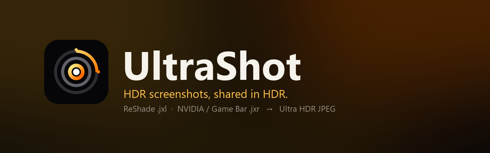
</p>

<p align="center">
  <a href="https://github.com/sgaddameedi/UltraShot/releases/latest"></a>
  <a href="LICENSE"></a>
  
  
  <a href="https://github.com/sgaddameedi/UltraShot/actions/workflows/ci.yml"></a>
</p>

# UltraShot: HDR game screenshots to Ultra HDR JPEG, for Instagram, Threads and the web

<p align="center"><b>Website: <a href="https://sgaddameedi.github.io/UltraShot/">sgaddameedi.github.io/UltraShot</a></b> &nbsp;·&nbsp; <a href="https://github.com/sgaddameedi/UltraShot/releases/latest">Download for Windows</a> &nbsp;·&nbsp; <a href="docs/instagram.md">Instagram guide</a></p>

UltraShot is a free, open-source Windows desktop application that converts HDR game screenshots into
Ultra HDR JPEGs. It reads the JPEG XL (`.jxl`) screenshots that ReShade saves and the JPEG XR (`.jxr`)
screenshots that the NVIDIA App and the Windows Game Bar save, and writes a gain-map JPEG that stays
HDR when it is posted to Instagram or Threads, uploaded to Google Photos, or opened in Chrome or Edge
on an HDR display. An Ultra HDR JPEG is an ordinary JPEG that carries a second, compact image called a
gain map, which tells an HDR-capable display how much brighter each pixel should be shown. The result
is a single file that displays as a normal photograph on any screen or service, and as a genuine HDR
image on phones, browsers and social platforms that understand the format.

The application accepts the lossless JPEG XL files written by ReShade and the JPEG XR files written by
the NVIDIA App and the Windows Game Bar, converts them with Google's libultrahdr encoder, and takes care
of the details that otherwise go wrong along the way: the HDR data is never tone-mapped or altered, the
gain-map metadata is written so that phones apply the full HDR range rather than a fraction of it, and
cropping and resizing for Instagram happen before upload, at full quality, so that Instagram's own
processing has no reason to discard the HDR layer.

## Why HDR screenshots are so hard to share

Modern games render in HDR, and a well-composed HDR screenshot can be striking. Sharing one is another
matter. The capture tools that preserve HDR save files that almost nothing else can open, and the
obvious workaround, converting them to an ordinary JPEG, flattens the picture into the SDR version the
game never intended. Uploading a true HDR format instead, such as an AVIF or a 16-bit PNG, is no better
in practice: most social platforms either refuse the file, strip the HDR on ingest, or pass it through
a compression pipeline that returns something dim and banded with the dynamic range gone.

The gain-map approach is the way through this. Because the file is structurally a JPEG, it survives
the upload pipelines that mangle everything else, and because the HDR information is stored as a
difference from a conventional base image, services that know nothing about HDR still show a correct
picture. The format is standardised as ISO 21496-1, Apple and Google both support it, and Instagram
and Threads have rendered it in HDR since 2024.

UltraShot began as a script written to get one person's screenshots onto their Instagram feed in HDR.
In the process it became clear that producing a technically correct gain-map file involves more than
calling an encoder. The reference encoder's defaults, for example, describe the image as if it were
intended for a 10,000-nit display, with the consequence that a typical phone applies only about a
third of the gain map and the picture looks merely "a bit brighter" rather than HDR. Instagram's upload
flow silently removes the gain map whenever the image is cropped, resized or filtered. The SDR fallback
image, which is what most viewers will see, deserves to be tone-mapped with some care rather than
clipped. UltraShot handles each of these, and wraps the result in an application that fits into a
capture workflow instead of interrupting it.

## From ReShade JXL and NVIDIA JXR to Ultra HDR JPEG

UltraShot converts ReShade JPEG XL captures (scRGB float or HDR10 PQ and HLG) and NVIDIA App and Game
Bar JPEG XR captures (scRGB float) into Ultra HDR JPEGs. Each capture produces a full-resolution file
and, optionally, a resized and cropped copy prepared for Instagram. Both carry a full-resolution,
multi-channel gain map encoded at quality 100 with 4:4:4 chroma, and both are signalled with ISO
21496-1 metadata as well as the Adobe and Android XMP form, so that older readers find the gain map
too. The capture's timestamp is preserved on the outputs so that photo libraries keep them next to the
original.

The application is built around three ways of working. Files and folders can be dropped onto the
window or chosen through a dialog, and converted in a batch. A watch folder can be enabled, in which
case every new capture is converted automatically a few seconds after the capture tool finishes
writing it; this is the default, and the application can start with Windows and run from the system
tray so that the workflow requires no attention at all. Finally, an entry can be added to Explorer's
right-click menu, and a second launch of the application, from a shortcut or from Explorer, hands its
files to the instance that is already running.

Before converting, each capture can be opened in an inspector that shows the SDR base image exactly as
SDR screens and thumbnails will see it, with live controls for exposure and highlight roll-off, a
positionable Instagram crop, and a highlights map that marks every pixel brighter than SDR white. None
of these controls affect the HDR layer, which is always written exactly as captured.

## Screenshots

<p align="center"><a href="https://raw.githubusercontent.com/sgaddameedi/UltraShot/main/docs/screenshots/main.png">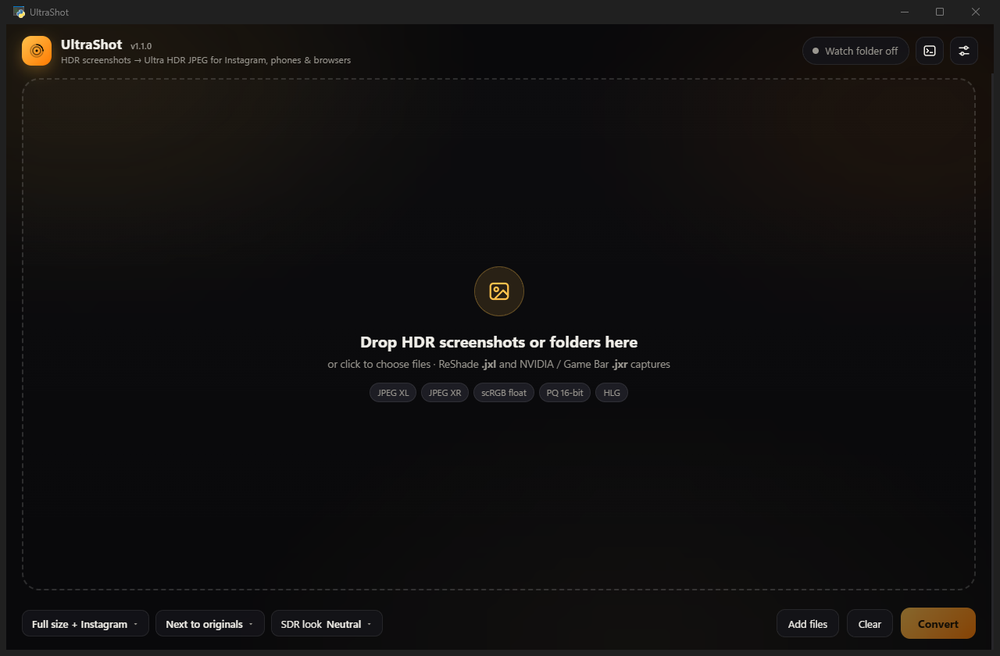</a></p>

<table>
  <tr>
    <td><a href="https://raw.githubusercontent.com/sgaddameedi/UltraShot/main/docs/screenshots/inspector.png">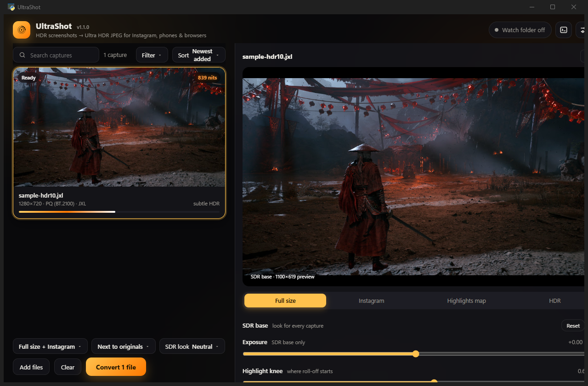</a></td>
    <td><a href="https://raw.githubusercontent.com/sgaddameedi/UltraShot/main/docs/screenshots/highlights-map.png">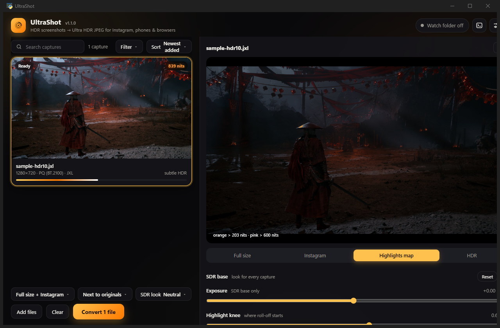</a></td>
  </tr>
  <tr>
    <td align="center"><sub>The inspector: a live preview of the SDR base image with exposure and highlight-knee controls</sub></td>
    <td align="center"><sub>The highlights map: orange marks pixels above SDR white, pink marks pixels above 600 nits</sub></td>
  </tr>
  <tr>
    <td><a href="https://raw.githubusercontent.com/sgaddameedi/UltraShot/main/docs/screenshots/instagram-crop.png">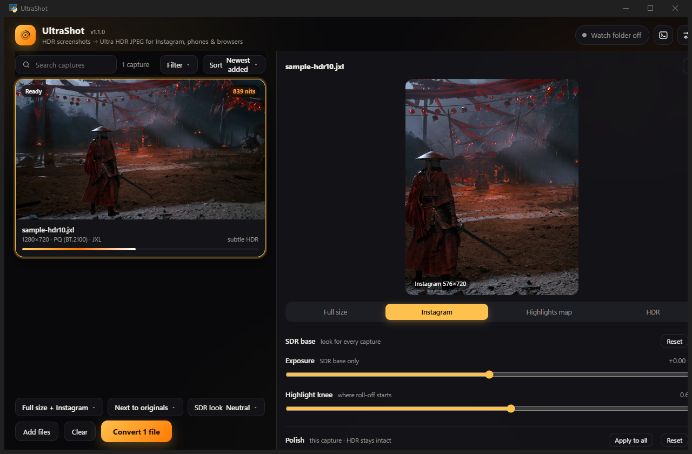</a></td>
    <td><a href="https://raw.githubusercontent.com/sgaddameedi/UltraShot/main/docs/screenshots/settings.png">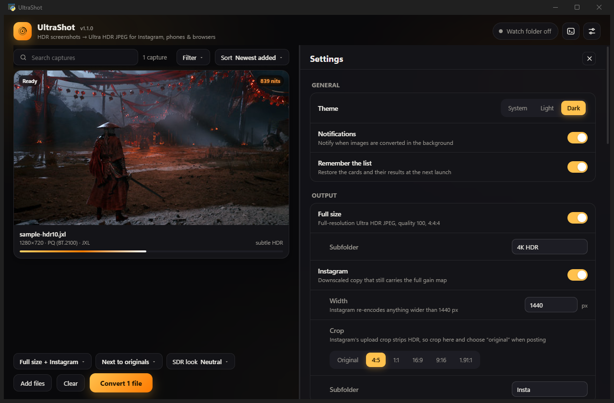</a></td>
  </tr>
  <tr>
    <td align="center"><sub>The Instagram output previewed with a 4:5 crop; drag the picture to frame it</sub></td>
    <td align="center"><sub>Settings</sub></td>
  </tr>
  <tr>
    <td><a href="https://raw.githubusercontent.com/sgaddameedi/UltraShot/main/docs/screenshots/compare.png">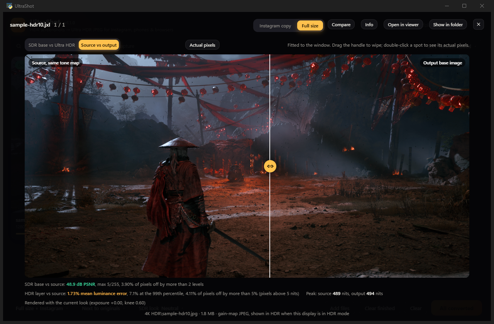</a></td>
    <td><a href="https://raw.githubusercontent.com/sgaddameedi/UltraShot/main/docs/screenshots/file-details.png">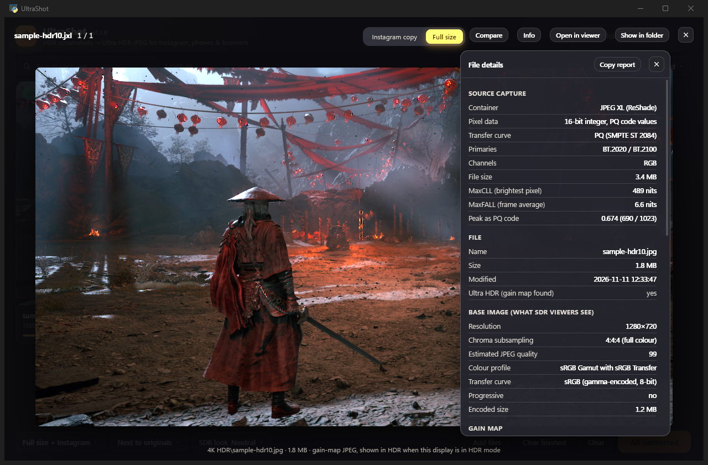</a></td>
  </tr>
  <tr>
    <td align="center"><sub>Compare: the original capture against the finished file at 1:1, with error metrics</sub></td>
    <td align="center"><sub>File details: what the finished JPEG actually contains, read back from disk</sub></td>
  </tr>
</table>

## Gallery

Every image below is a full 3840×2160 Ultra HDR JPEG exactly as UltraShot wrote it, served from this
repository. On an HDR display, Chrome and Edge render them in HDR on this page; on an SDR display you
see the base image, which is the point of the format. Click any of them to open the file on its own.

<table>
  <tr>
    <td><a href="https://raw.githubusercontent.com/sgaddameedi/UltraShot/main/examples/gallery/phantom-blade-zero-lake-sunset.jpg">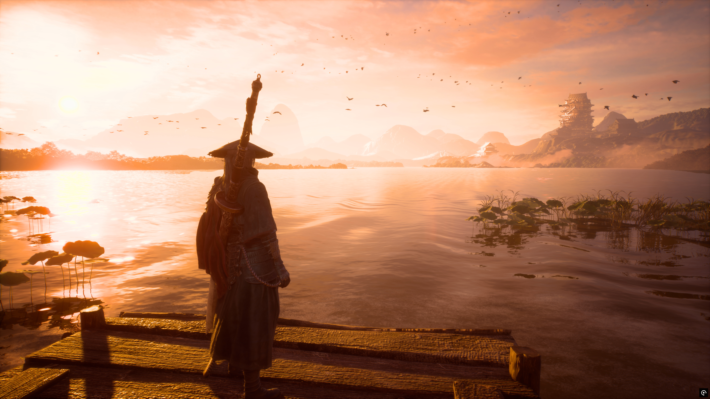</a></td>
    <td><a href="https://raw.githubusercontent.com/sgaddameedi/UltraShot/main/examples/gallery/phantom-blade-zero-lantern-stairs.jpg">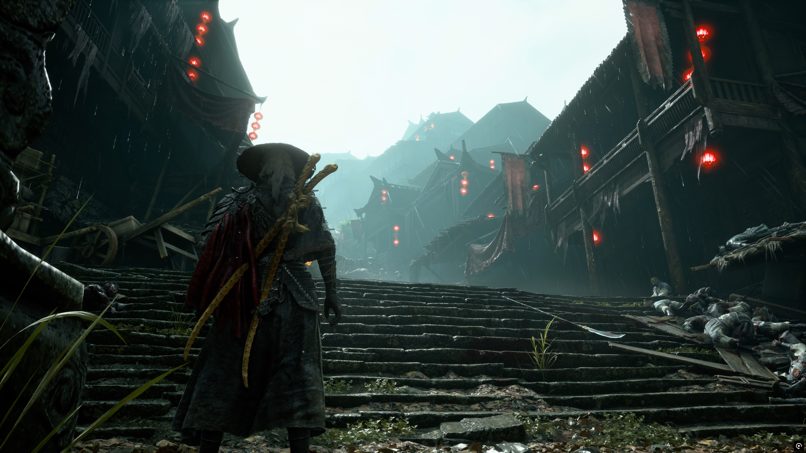</a></td>
  </tr>
  <tr>
    <td align="center"><sub>Sunset over the lake. 18 % of the frame sits above SDR white; peak 2300 nits.</sub></td>
    <td align="center"><sub>Lantern stairs. Peak 2800 nits, 8 % of the frame above 600 nits.</sub></td>
  </tr>
  <tr>
    <td><a href="https://raw.githubusercontent.com/sgaddameedi/UltraShot/main/examples/gallery/phantom-blade-zero-mountain-village.jpg">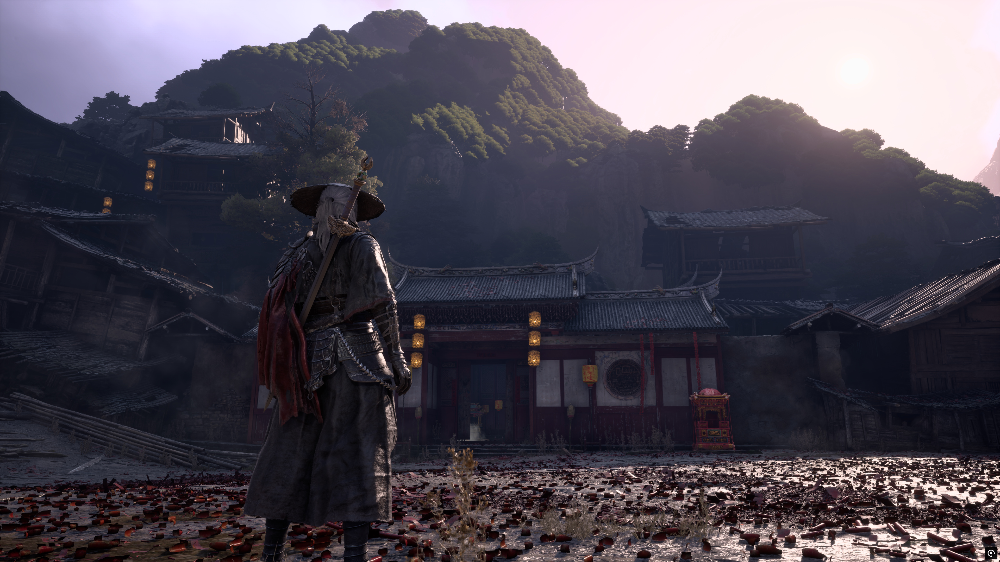</a></td>
    <td><a href="https://raw.githubusercontent.com/sgaddameedi/UltraShot/main/examples/gallery/phantom-blade-zero-golden-field.jpg">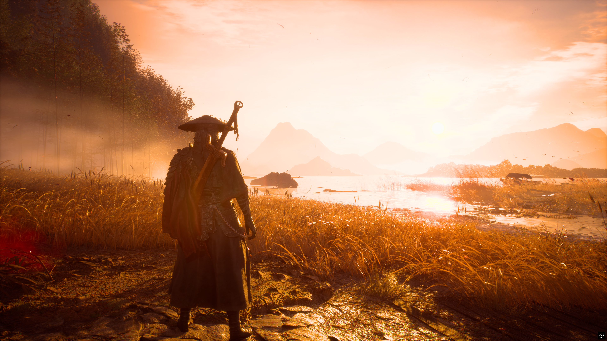</a></td>
  </tr>
  <tr>
    <td align="center"><sub>Mountain village. Peak 3100 nits.</sub></td>
    <td align="center"><sub>Golden field. 21 % of the frame above SDR white.</sub></td>
  </tr>
  <tr>
    <td><a href="https://raw.githubusercontent.com/sgaddameedi/UltraShot/main/examples/gallery/crimson-desert-red-sunset.jpg">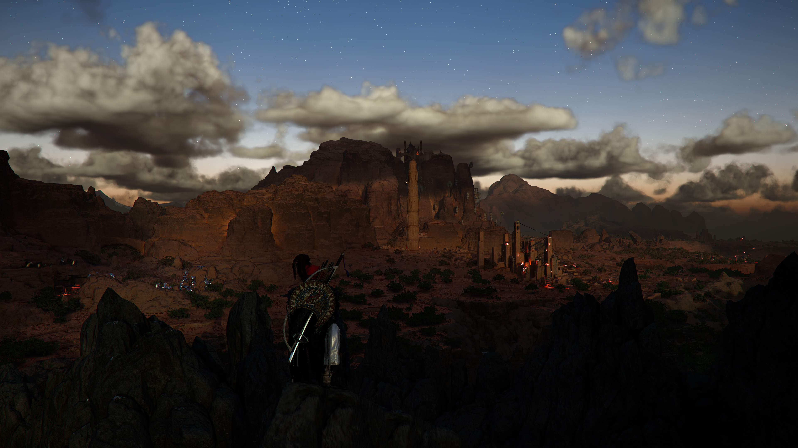</a></td>
    <td><a href="https://raw.githubusercontent.com/sgaddameedi/UltraShot/main/examples/gallery/crimson-desert-storm-sky.jpg">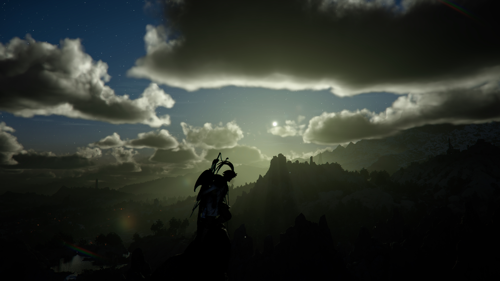</a></td>
  </tr>
  <tr>
    <td align="center"><sub>Crimson Desert, red sunset. NVIDIA App capture, peak 2250 nits.</sub></td>
    <td align="center"><sub>Crimson Desert, storm sky. NVIDIA App capture, peak 1000 nits.</sub></td>
  </tr>
</table>

More are in [examples/gallery](examples/gallery), and the [project site](https://sgaddameedi.github.io/UltraShot/) shows all of them.
## Getting started

### Installing

Download `UltraShot-<version>-windows-x64.zip` from the
[latest release](https://github.com/sgaddameedi/UltraShot/releases/latest), extract it to any folder
and run `UltraShot.exe`. The application requires Windows 10 or 11 with the Edge WebView2 runtime,
which is part of every current Windows installation, and nothing else. There is no installer and
nothing is written outside the application folder, your `%APPDATA%\UltraShot` settings folder, and the
Startup shortcut and Explorer entry that you can enable in Settings.

On first launch UltraShot begins watching `Videos\Captures`, the folder the Windows Game Bar uses and
the one most ReShade users point their screenshots at, and registers itself to start with Windows in
the tray. Both behaviours can be changed in Settings; if you would rather it did nothing on its own,
turn off *Convert new captures automatically* and *Start with Windows*.

The same build is also published to winget as `sgaddameedi.UltraShot` (`winget install UltraShot`
once the listing is accepted), and [docs/store.md](docs/store.md) describes how the Microsoft Store
package is produced from it.

### Running from source

The application is written in Python and runs from a checkout with the dependencies listed in
`requirements.txt`:

```bash
git clone https://github.com/sgaddameedi/UltraShot.git
cd UltraShot
pip install -r requirements.txt
python ultrashot.py
```

`UltraShot.bat` starts it without a console window. Building the standalone executable is described
under [Building](#building-the-executable).

### Your first conversion

Take a screenshot in an HDR game with ReShade, the NVIDIA App (Alt+F1) or the Game Bar
(Win+Alt+PrtScn), making sure that HDR is enabled both in Windows and in the game; the guide at
[docs/capture.md](docs/capture.md) covers the settings for each tool. If the capture lands in the
watch folder it is converted within a few seconds; otherwise drop it onto the UltraShot window and
press *Convert*. The outputs are written next to the capture:

```
Videos\Captures\
├── Screenshot.jxl
├── 4K HDR\Screenshot.jpg      the full-resolution Ultra HDR JPEG
└── Insta\Screenshot.jpg       the 1440-pixel copy prepared for Instagram
```

Opening either file in Chrome or Edge on an HDR monitor shows the HDR rendering immediately, which is a
convenient way to check a result without involving a phone.

## Working with UltraShot

### Converting captures

Drop `.jxl` or `.jxr` files, or folders containing them, anywhere on the window. Each capture appears
as a card showing a thumbnail of its SDR rendering, its resolution and source format, the brightest
value in the frame in nits, and a short classification of how much of the frame exceeds SDR white.
A bar above the tiles searches by name, filters by state, capture format or polish, and sorts by
when a capture was added or taken, by name, by peak brightness or by size; the Convert button and
the viewer follow what is shown. *Convert* processes every card in turn; *Convert selected* in the inspector processes one. Captures
whose outputs already exist are skipped unless *Overwrite existing outputs* is enabled, so it is safe
to drop an entire folder repeatedly. Double-clicking a finished card opens the result: in your
default viewer when it is the only one, or in the built-in viewer that steps through every converted
capture and, on an HDR display, shows the gain-map JPEG in HDR. Its *Info* panel reads the finished
file back and lists what it actually contains, from chroma subsampling and the embedded colour
profile to the gain-map metadata and the peak brightness a phone will reconstruct, with a
*Copy report* button for bug reports. *Compare* opens a wipe you drag across the picture: between
the SDR base and the Ultra HDR rendering, which only separates on an HDR display, or at actual
pixels between the original capture and the finished file, rendered through the same tone map so
that the only differences left are the ones the encoder introduced. That second mode also prints
how close the file is to the source, as a PSNR for the base image and as luminance error for the
reconstructed HDR layer, so you can see for yourself that the conversion is lossless in every way
that matters.

### Polishing a capture

The inspector's Polish section holds the few adjustments worth making to a game capture before it
goes out: warmth, contrast, vibrance and shadows, each a single slider, plus a watermark field for
your handle. They are deliberately few, and they are built so that they cannot damage the HDR. The
adjustments run in the converter's own linear-light space before anything is rounded, so the
source file is never touched and the only quantisation is the final JPEG encode, exactly as
without them. Contrast and shadows fade out above SDR white, which leaves the sun, the sky and the
lanterns at precisely the brightness they were captured at; warmth and vibrance move colours
around their own luminance without changing it; the watermark is drawn at SDR white so it reads
the same on every screen; and nothing is ever pushed above the capture's own peak or below black.
Polish is per capture and remembered with the list. Apply to all copies one capture's settings to
every other card, Reset clears them, and a polished card shows a small mark in its caption. The
preview above the sliders updates as you drag, and the HDR tab shows the finished Ultra HDR
picture itself, in real HDR on an HDR display, so you grade what you will actually post.
Changing the polish of a converted capture puts it back to pending so that Convert writes the new
version, and a converted card can be converted again at any time, replacing the earlier files,
from the inspector's button or the card's right-click menu, which also offers the result, the
capture, their folders, a reset of polish and framing, and removal from the list. The inspector,
settings and log open as panes beside the list; drag a pane's header to rearrange them and its
left edge to resize it, and the arrangement is remembered.

### Adjusting the SDR base image

Clicking a card opens the inspector. The preview is the SDR base image, which is the version that
non-HDR screens, thumbnails, and any service that discards the gain map will show, and it is worth a
moment's attention because it is what most viewers see. *Exposure* brightens or darkens it in
photographic stops; dark game scenes often benefit from a third to half a stop. *Highlight knee* sets
the luminance at which the roll-off toward white begins. A lower value preserves more detail in bright
areas at the cost of a flatter look, while a higher value gives more contrast and lets more of the
highlights clip. The *SDR look* menu in the bottom bar offers presets for common cases.

The *Highlights map* view replaces the preview with a false-colour rendering: pixels brighter than SDR
white are shown in orange and pixels brighter than 600 nits in pink. It answers the question of what an
HDR display will actually do with the image, which the SDR preview cannot show.

None of these controls change the HDR layer. The scene brightness captured by the game is what the HDR
viewer reconstructs, whatever the SDR base looks like.

### Posting HDR screenshots to Instagram

Instagram displays gain-map JPEGs in HDR, but its upload flow removes the gain map the moment the image
is cropped, resized or filtered. The practical rule is that the image must be finished before it is
uploaded. UltraShot's Instagram output is 1440 pixels wide, the width Instagram stores, and can be
cropped to 4:5, 1:1, 16:9, 9:16 or 1.91:1, framed per capture by dragging the picture inside the crop window in the inspector, the way Instagram's own editor works. When uploading,
use a desktop browser or an Android device, select *Original* in the aspect-ratio menu, and apply no
adjustments. The full procedure, with notes on which other services preserve the gain map, is in
[docs/instagram.md](docs/instagram.md).

### Running in the background

Closing the window hides UltraShot in the system tray, where the icon's menu can open the window,
toggle the watch folder, open the watch folder in Explorer, or quit. With *Start with Windows* enabled,
a shortcut in the Startup folder launches the application hidden at sign-in. The watch folder can
include subfolders, which matters for NVIDIA App captures because the NVIDIA App keeps a separate
subfolder for each game. Notifications announce finished conversions while the window is hidden.

## Supported HDR screenshot formats

| Capture tool | File | Contents | Notes |
| --- | --- | --- | --- |
| ReShade 6.x | `.jxl` | Float16 scRGB (BT.709 primaries, 1.0 = 80 nits) for scRGB games; 16-bit PQ or HLG (BT.2100) for HDR10 games | Lossless, and the best source available. Select JPEG XL as the screenshot format in ReShade's settings. |
| NVIDIA App, GeForce Experience | `.jxr` | Float scRGB | Saved to `Videos\NVIDIA\<game>`; enable *Include subfolders*. |
| Windows Game Bar | `.jxr` | Float scRGB | Saved to `Videos\Captures`, the default watch folder. |

Float input is interpreted as scRGB and 16-bit input as PQ. Games that output HLG are rare; for them,
*Input transfer* in Settings can be set to HLG.

## How the gain-map conversion works

<p align="center">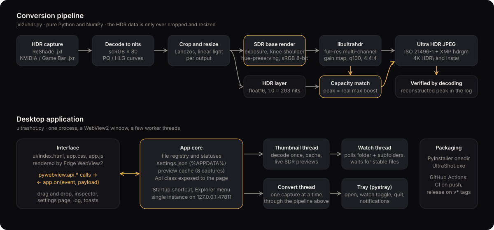</p>

The conversion engine lives in a single module, `jxl2uhdr.py`, and the application is a shell around
it. A detailed description is in [docs/how-it-works.md](docs/how-it-works.md); in outline, the process
has five stages.

The capture is first decoded to absolute luminance. scRGB values are multiplied by 80 nits, and PQ or
HLG code values are converted through the ST 2084 and BT.2100 transfer functions, giving a floating
point image in nits per channel. From this point the HDR data is modified only geometrically: cropping
to the requested aspect ratio and Lanczos resizing, both performed in linear light.

The SDR base image is then rendered from the same data. Values are scaled so that 1.0 corresponds to
203 nits, the SDR reference white, and the exposure adjustment is applied. Luminance below the knee is
left untouched, and luminance above it is compressed with a smooth shoulder that preserves the
distinction between moderately and very bright highlights instead of clipping both to white. The
compression is applied equally to all three channels so that hues are preserved, and any channel that
still exceeds the range is pulled toward the pixel's luminance rather than cut off.

Both images are passed to libultrahdr, which computes a full-resolution, multi-channel gain map and
writes the JPEG container. UltraShot then reads the gain map's actual maximum boost back from the file
and, if the encoder's declared display capacity does not match it, encodes a second time with the
target peak set to that value. This is the step that makes the difference on phones: a viewer applies
the gain map in proportion to how its display's headroom compares with the declared capacity, so a
capacity of 10,000 nits on an image whose content reaches 1,000 leaves most of the HDR unapplied.

Finally the Adobe and Android XMP metadata is added alongside the ISO 21496-1 metadata that libultrahdr
writes, and the finished file is decoded once more so that the log can report the peak brightness an
HDR viewer will reconstruct.

## Command-line use

The engine can be used without the application, which is convenient for scripts and for machines
without a display:

```bash
python jxl2uhdr.py capture.jxl output.jpg
python jxl2uhdr.py capture.jxr instagram.jpg --max-width 1440 --crop 4:5 --exposure 0.3
python tools/watch_cli.py "D:\Captures" --ig-crop 4:5
```

`python jxl2uhdr.py --help` lists every option, including the highlight knee, the automatic SDR
tone map, JPEG quality, the input transfer function and the gain-map target peak.

## Configuration

All settings are reachable from the sliders icon in the top bar and are stored as JSON in
`%APPDATA%\UltraShot\settings.json`. The defaults are deliberately opinionated, producing both outputs,
watching `Videos\Captures` with its subfolders, starting with Windows and remaining in the tray.
[docs/settings.md](docs/settings.md) describes every setting and the command-line flags.

## Building the executable

```bash
pip install -r requirements-dev.txt
build_exe.bat
```

This produces `dist\UltraShot\UltraShot.exe` together with its support files, roughly 100 MB in total,
most of which is the Python runtime, NumPy and the codec library. Pushing a tag of the form `v1.2.3`
runs the same build on GitHub Actions and attaches the zipped result to a release.

## Frequently asked questions

**Why does the converted image look like SDR on my phone?** The viewing application has to support
gain maps, and the display has to be in a mode that permits HDR. Google Photos, Chrome, Instagram,
Threads and Samsung Gallery all qualify; most messaging applications re-encode images and strip the
gain map, and Windows Photos does not render gain maps at all. Sending the file through a messaging
application as a document rather than a photo usually preserves it.

**Why does Instagram show my HDR screenshot dim, or in SDR?** The image was cropped, zoomed, filtered or otherwise
adjusted during upload, or was uploaded from an iPhone, which transcodes it. See
[docs/instagram.md](docs/instagram.md).

**Why does UltraShot say the input looks like an SDR screenshot?** The file contains 8-bit data, which
means the game or Windows was not in HDR mode when the capture was taken. Both have to be enabled.

**Why does the SDR preview of an HDR10 game look washed out?** HDR10 titles frequently sit far below 203 nits
on average, so the base image can look flat at the default settings. Raise the exposure or lower the
knee in the inspector until it looks right; the HDR layer is unaffected.

**What does "subtle HDR" on a card mean?** Fewer than half a percent of the pixels exceed SDR white, which simply
describes the scene. The highlights that do exist are carried in full.

**How do I open a ReShade .jxl or an NVIDIA .jxr screenshot?** Very little software reads either
format, which is the problem UltraShot exists to solve. Drop the file onto UltraShot and the Ultra HDR
JPEG it writes opens anywhere a JPEG does, in HDR wherever gain maps are supported. The engine can also
be called from the command line, as described under [Command-line use](#command-line-use).

**Is an Ultra HDR JPEG a real HDR image or just a brighter JPEG?** It is a real HDR image. The gain map
stores, per pixel, how far the scene exceeds the SDR base, and an HDR viewer reconstructs the captured
brightness from it. UltraShot never tone-maps the HDR layer; only the SDR fallback is adjusted.

Further questions and failure modes are covered in [docs/troubleshooting.md](docs/troubleshooting.md).

## Project status and roadmap

UltraShot is in regular use and the conversion path is covered by tests, but it is a young project
maintained by one person, and reports from other games, capture tools and phones are the most useful
contribution it can receive. The roadmap, in rough order of priority, is an HDR preview inside the
application, AVIF and HDR PNG outputs for platforms that prefer them, OpenEXR and Radiance HDR input,
and macOS and Linux versions of the application shell, since the engine already runs wherever its
dependencies do.

## Contributing

Bug reports with a sample capture and a note of the viewer you used are especially welcome, as are
pull requests. [CONTRIBUTING.md](CONTRIBUTING.md) describes the development setup, the layout of the
code and the project's one firm rule, which is that nothing may alter the HDR layer.

## Acknowledgements

UltraShot stands on the work of several other projects. [libultrahdr](https://github.com/google/libultrahdr)
by Google performs the gain-map encoding. [imagecodecs](https://github.com/cgohlke/imagecodecs) by
Christoph Gohlke packages that encoder together with the JPEG XL and JPEG XR decoders in a single
Python wheel, which is what makes a dependency-free Windows build practical.
[pywebview](https://pywebview.flowrl.com/) and [pystray](https://github.com/moses-palmer/pystray)
provide the desktop shell. [hdrshot](https://github.com/snaketech-tu/hdrshot) set the bar for what an
approachable HDR screenshot tool should look like, and Greg Benz's
[HDR photography guides](https://gregbenzphotography.com/hdr-photos/) document, better than anyone,
what social platforms actually do with gain-map files.

## License

UltraShot is released under the [MIT License](LICENSE). Copyright © 2026 sgaddameedi.
